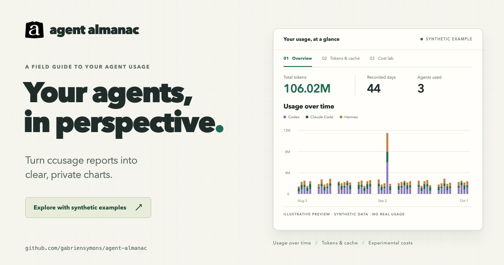
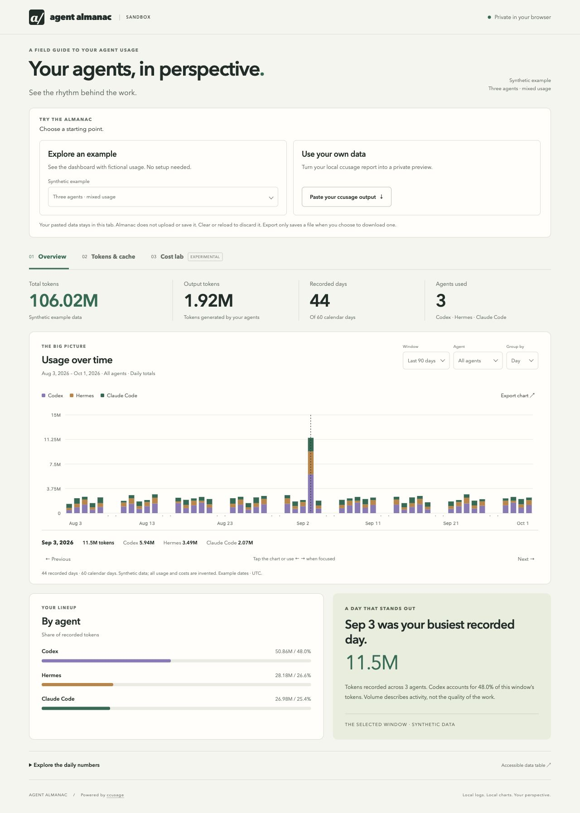

# Agent Almanac

Turn [ccusage](https://ccusage.com/) reports into a local dashboard: see usage over time, compare coding agents, explore token and cache patterns, and inspect experimental cost estimates.

**Early alpha.** No account, database, or frontend dependencies. The dashboard stays on your machine; the sandbox processes pasted reports in your browser.

[](https://gabriensymons.github.io/agent-almanac/)

## Quick start

**New to ccusage? Try the dashboard with examples first.** ccusage summarizes usage logs from your coding agents. Almanac turns those reports into charts so you can explore usage patterns, compare agents, and understand token and cache activity. The sandbox includes five synthetic reports; you don't need agent history or a ccusage installation to explore them.

You need [Git](https://git-scm.com/install/) and [Bun 1.4.2 or newer](https://bun.com/docs/installation) to run locally. Reuse them if already installed. Node.js and Docker are not required.

<details>
<summary>Install Bun if you don't have it yet</summary>

macOS Terminal:

```sh
curl -fsSL https://bun.com/install | bash
```

Windows PowerShell:

```powershell
powershell -c "irm https://bun.com/install.ps1 | iex"
```

Close and reopen your terminal window, then check `bun --version`. See the [official installation guide](https://bun.com/docs/installation) for requirements and alternatives.

</details>

### 1. Explore an example

Clone the repository and start the sandbox. During the private alpha, cloning requires repository access and GitHub authentication.

```sh
git clone https://github.com/gabriensymons/agent-almanac.git
cd agent-almanac
bun run preview:sandbox
```

Open http://127.0.0.1:4319/agent-almanac/ and choose **Explore an example**. Switch between Overview, Tokens & cache, and Cost lab, then try the filters or export a chart. This preview needs no dependency installation and reads no local agent logs.

**Hosted demo:** the [public sandbox URL](https://gabriensymons.github.io/agent-almanac/) is planned for GitHub Pages and is not live yet. Use the local preview above for now.

### 2. See your own usage

Stop the sandbox with **Ctrl+C**, then run these commands from the same checkout:

```sh
bun install --frozen-lockfile --ignore-scripts
bun start
```

Open http://127.0.0.1:4318/. **The install includes ccusage 20.0.29 automatically**; a separate global installation is not needed. The first visit reads existing local agent logs. **Refresh data** reads new usage, while ordinary page reloads reuse the last successful snapshot.

Haven't used a supported coding agent on this machine yet? An empty dashboard is expected. ccusage summarizes existing history; the sandbox examples let you explore the charts before you have your own.

## Using the sandbox

You can also choose **Use your own data** to paste a report into the sandbox. The paste form selects a command for your terminal: macOS uses `bunx ccusage daily --json --by-agent | pbcopy`, and Windows PowerShell uses `bunx ccusage daily --json --by-agent | Set-Clipboard`. Bun downloads ccusage if needed, so you don't need to install it globally. After a successful command, return to the sandbox and paste the JSON from your clipboard. You can also select plain JSON output for other terminals.

<details>
<summary>See the sandbox with synthetic usage</summary>



</details>

Supported paste formats:

- Daily JSON from `ccusage daily --json --by-agent` (recommended).
- Standard daily JSON without agent breakdowns, shown as combined usage.
- A complete wide unified daily terminal table, including the header, per-agent rows, and Total row. Terminal costs are rounded; pricing-availability metadata is absent.

Compact, monthly, and session tables are not supported. Invalid or truncated reports show an error and leave the previous chart visible. The paste limit is 2 MB.

**Pasted data is not uploaded or stored by Almanac.** Parsing and charting happen in the tab, with no analytics or API calls. Clear or reload discards the preview. An SVG is saved only when you select Export. The hosting provider still receives normal requests for the public page and its static assets; pasted report contents are not part of those requests.

## Verified environments

Device checks reported on October 16, 2026:

| Environment | Bun | Browser tested | Result |
| --- | --- | --- | --- |
| macOS 26.6.2, Apple Silicon | 1.4.3 | Chrome 154.0.8037.58 | Install, 22 tests, startup, and dashboard/sandbox checks passed at `feb9280`. |
| Windows 11 Home, build 22631, x64; PowerShell 5.1 | 1.4.3 | Firefox 146.0.1, 64-bit | Install, 31 tests, empty dashboard, sandbox, both clipboard commands, and synthetic-data privacy checks passed at `45efec4`. |

The Windows PC had no agent history, so collection from real Windows logs remains untested. The Mac laptop report did not specify whether its local dashboard had history. The newer sandbox UI was included in the Windows checks.

[Hosted CI passed on macOS, Windows, and Linux](https://github.com/gabriensymons/agent-almanac/actions/runs/38972647037) with Bun 1.4.2 at `3eef7ff071c338144dce9e4407cda91bd4794b84`, including the logo, favicons, and updated social card. These results do not establish a live GitHub Pages deployment. Follow the [clean-install checklist](docs/clean-install.md) to verify another machine.

## Configuration and troubleshooting

Use `PORT` to change the local port and `TZ` to select the report timezone. Defaults are port 4318 and the machine's timezone.

```sh
# macOS / Linux
PORT=4320 TZ=America/New_York bun start
```

```powershell
# Windows PowerShell (current terminal session)
$env:PORT = '4320'
$env:TZ = 'America/New_York'
bun start
```

The dashboard invokes its installed ccusage executable directly with `daily --json --by-agent --offline`. Refresh times out after 90 seconds. Offline pricing may differ from online estimates. To diagnose missing data or an incompatible report, run:

```sh
bun run ccusage --version
bun run ccusage daily --json --by-agent --offline
```

An installation needs network access to download locked packages. Starting the dashboard never installs or updates packages. Do not omit optional dependencies: ccusage uses an optional package for the platform binary. If port 4318 is busy, stop the other instance or choose another port.

## Reading the charts

- Overview uses ccusage's reported total tokens. Windows end on the latest recorded date, not today's date.
- Weekly groups start on Monday; buckets at the window edges can be partial. Histories over two years use weekly marks.
- Blank dates mean no available records, not proven inactivity. The latest day may be incomplete.
- Tokens & cache sums four reported categories, which can differ from the headline total. Cache share is `cache read / (input + cache write + cache read)`; output is excluded.
- Cost lab is experimental. Cached prices, unpriced models, subscriptions, and provider accounting can make estimates differ from bills. Token volume does not measure productivity or quality.

The dashboard supports date/agent filters, keyboard and touch inspection, a daily data table, and SVG exports. Local dashboard filters are saved in the URL. Sandbox state and pasted data stay out of the URL.

## Local data and privacy

The dashboard binds to **127.0.0.1 only**, checks request hosts/origins, and has no accounts. Do not expose it through a public tunnel.

ccusage reads the sources it detects. Almanac keeps daily aggregate metrics, agent/model names, pricing availability, and snapshot metadata in `.data/usage.json`, ignored by Git. It does not serve conversation logs, prompts, project paths, or session identifiers. Failed refreshes preserve the last successful snapshot.

Personal snapshots and screenshots belong in `.data/`. Review exports before sharing them. The static sandbox build copies only a fixed list of public files and synthetic examples; it never packages `.data`, the local server, ccusage, or planning documents.

## Development and deployment

```sh
bun install --frozen-lockfile --ignore-scripts
bun test
bun run build:sandbox
bun run preview:sandbox
```

Tests cover normalization, calendar gaps, weekly totals, imports, missing costs, installed ccusage version, static build contents, and isolated server startup/recovery. `.github/workflows/ci.yml` runs them on three operating systems.

The sandbox is an ordinary static site in `dist/sandbox`. To host it like hbsguard, enable **Settings → Pages → GitHub Actions** on the public repository, then manually run **Deploy Sandbox**. The workflow tests and builds before uploading only `dist/sandbox`. After a successful deployment, verify the public URL and remove the pending-deployment note above. Pushes alone do not publish the sandbox.

The repository social card is [assets/social/agent-almanac-og.png](assets/social/agent-almanac-og.png), with an [editable HTML source](assets/social/agent-almanac-og.html). It uses only synthetic example data. Render the source at a 1200 × 630 CSS-pixel viewport with 2× device scale to produce a 2400 × 1260 PNG with sharper text on high-density displays; upload the PNG in the repository's **Settings → General → Social preview** to use it on shared GitHub links.

Maintainer planning is separate from this source repository. Please report problems using a small synthetic report rather than private usage logs.

## License

[MIT](LICENSE). Built on ccusage; this project is an independent visualization companion.
